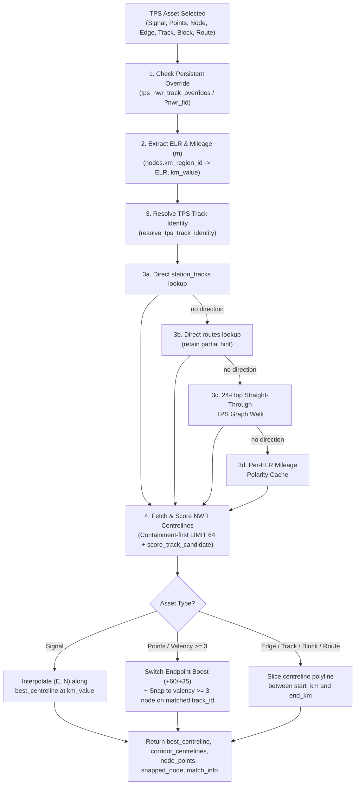

# TPS-to-Geographic (NWR OSGB36) Track Matching & Plotting Guide

This document explains how the application maps railway assets from the **Network Rail TPS Schematic Model** (`XML_p.xml` in schematic `netx, nety` coordinates) onto the **NWR Geographical Track Model** (OSGB36 Eastings/Northings shapefiles).

It is written in two parts:
1. **Data Science & Engineering Reference** — how the 5-stage matching, scoring, snapping, and override pipeline works.
2. **Reusable AI / LLM Prompt Pack** — a copy-pasteable prompt to brief another AI assistant on the exact domain rules, invariants, and debugging workflow.

---

## 1. The Core Problem

TPS and the NWR Track Model are independent datasets with **no shared foreign key** between individual tracks, signals, or points:

- **TPS** provides topological connectivity (`nodes`, `edges`), operational track labels (`station_tracks`, `routes`), signalling metadata (`signals`, `blocks`), line speeds (`edges.vmax`), and linear referencing (**ELR** via `km_region_id` + **mileage** in metres via `km_value`).
- **NWR Track Model** provides OSGB36 polyline geometries (`nwr_track_centrelines`) and physical turnout/boundary nodes (`nwr_track_nodes` with `valency`), keyed by **ELR**, **4-digit Appendix A `track_id`**, and **chainage** (`start_meters`, `end_meters`).

Plotting a TPS asset onto the geographic map therefore requires answering two questions:
1. **Which parallel NWR `track_id` at `(ELR, km_value)` does this TPS asset physically sit on?**
2. **Where along that centreline (or at which physical switch node) should the marker be placed?**

---

## 2. End-to-End Pipeline



All core logic lives in `backend/main.py` (`load_elr_polarity_cache`, `_extract_direction_from_tokens`, `_extract_platform_number`, `_parse_station_track_rows`, `resolve_tps_track_identity`, `score_track_candidate`, `find_nwr_cross_links_for_tps`).

---

## 3. Stage-by-Stage Technical Breakdown

### Stage 1: TPS Track Identity Resolution (`resolve_tps_track_identity`)

Given a TPS asset's node(s) `(start_node_id, end_node_id, point_node_id)`, ELR, and mileage, the resolver extracts:
- `direction_hint`: `"up"`, `"down"`, or `"reversible"`
- `secondary_dir`: `"up"` or `"down"` tiebreaker when `direction_hint == "reversible"` (used when NWR codes a bi-directionalised main line as `1xxx`/`2xxx` instead of `3xxx`)
- `track_name_hint`: combined operational label (`name | description | sa_line_code | rop_line_code`)
- `platform_num`: integer `1..99` extracted from platform, line, bay, or siding numbers (e.g. `D-12 → 12`, `U-L3 / Line 3 → 3`, `Middle Siding 1 → 1`, `U-DL2 → 2`)
- `source`: human-readable audit trail shown in the Inspector UI (e.g. `TPS Track Walk (2 hops: U-UF / U-UF Fast Up)`)

Resolution runs in four cascading steps:

1. **Direct `station_tracks` lookup** (GIN-indexed on `node_ids`):
   - Prefers rows containing both `start_node_id` and `end_node_id` in forward order (`index(start) < index(end)`).
   - Detects **reversible pairs**: if the same physical track (`longname`) has both an Up and a Down row on the matched node(s) (e.g. `D-12` + `U-12` at Crewe, or `D-MBR` + `U-MBR` at Euston), sets `direction_hint = "reversible"` while keeping `secondary_dir`.
   - Recognizes UK rail bi-directional codes (`UD*`, `U&D*`, `D&U*`, `U/D*`, `D/U*`, `RVL`, `BGL`, `REV`, `BI`, `BD`) and physical-line suffixes (`U-DML` = physically Down Main worked in the Up direction).
2. **Direct `routes` lookup** (GIN-indexed on `node_ids`):
   - Decodes `sa_line_code_id` (`salinecodedesc`) and `rop_line_code_id` (`roplinecodedesc`).
   - **Important**: If a route only supplies a directionless code (e.g. `ML` = Main Line), it is kept as a `partial_hint` and does **not** return early — execution continues to Step 3 and Step 4 to resolve direction.
3. **24-Hop Straight-Through TPS Graph Walk**:
   - Open-line signals and points sit between `station_tracks`. The walker traverses connected TPS `edges` in both directions from `(end_node_id, start_node_id)` and `(start_node_id, end_node_id)` for up to 24 hops.
   - Through **valency-2** nodes: continues unconditionally.
   - Through **turnouts (`deg >= 3`)**: computes the schematic unit vector `prev → curr` in `(netx, nety)` and only follows the single outgoing leg with cosine similarity `>= 0.92` (deflection `<= ~23°`). This passes cleanly through crossovers without ever jumping sideways onto a parallel line.
   - **Hop-1 Turnout Discovery (for Points / Crossover Legs)**: A `POINTS:` asset's `(start_node_id, end_node_id)` is often the 45° diverging crossover leg. At Hop 1, if no outgoing leg satisfies `cos_sim >= 0.92`, the walker finds the two incident edges at that turnout most collinear with each other (`cos_sim <= -0.92`) — i.e. the main running line passing straight through the switch — and walks along that running line.
4. **Data-Driven Per-ELR Mileage Polarity Cache (`load_elr_polarity_cache`)**:
   - **Never assume `start_km < end_km` means Down.** Across Great Britain, **247 of 1,106 ELRs (~22%)** are reverse-chained where Down runs in *decreasing* mileage (e.g. `CMD1`).
   - On first use, the backend computes each ELR's polarity (`+1` or `-1`) directly from directed `station_tracks` in PostgreSQL and caches it in memory.

---

### Stage 2: NWR Candidate Retrieval & Appendix A Track Scoring

In NWR's 4-digit `track_id` (`D C NN`):
- **Digit 1 (`D`) — Direction**: `1` = Up, `2` = Down, `3` = Reversible/Bi-directional, `4` = Non-directional
- **Digit 2 (`C`) — Track Class**:
  - `1` = Main / Fast (`1100`, `2100`, `3101`)
  - `2` = Slow / Relief (`1200`, `2200`, `3204`, `3212`)
  - `3` = Goods / Freight (`1300`, `2300`, `3300`)
  - `4` = Single (`1400`, `2400`, `3400`)
  - `5` = Loop / Platform Loop (`1500`, `2500`, `3500`)
  - `6` = Terminal / Bay (`3601`–`3617`)
  - `7` = Crossover (`3700`–`3799`)
  - `8` = Other / Engine / Carriage / Reception (`3800`–`3850`)
  - `9` = Siding / Yard / Depot (`1901`, `2901`, `3901`)
- **Digits 3–4 (`NN`) — Sequence Number**: `00` for primary open-line tracks; `01`–`99` for numbered platforms, numbered approach lines (Paddington `3101`–`3206`), or numbered sidings (`3901`–`3906`).

#### Candidate Query
`find_nwr_cross_links_for_tps` queries `nwr_track_centrelines` within `±400 m` (or `±300 m` of a span), ordered by **strict mileage containment first**, then midpoint distance, with `LIMIT 64`. This ensures long through-platforms at major hubs (Crewe, Euston, Paddington) are never truncated behind short crossovers or bays.

#### Scoring Matrix (`score_track_candidate`)

| Factor | Condition | Weight |
| --- | --- | ---: |
| **Base** | All candidates | `+50` |
| **Coverage** | Strictly contains `target_m` (`min_m <= target_m <= max_m`) | `+85` |
| | Within `50 m` margin | `+35` |
| | Outside margin (`dist` to nearest endpoint) | `-(40 + min(40, dist * 0.15))` |
| **Direction** | Exact Up (`1xxx`) or Down (`2xxx`) match | `+70` |
| | Reversible (`3xxx`) when Up/Down hinted | `+25` |
| | Opposite direction (`1xxx` vs Down, `2xxx` vs Up) | `-60` |
| | Reversible hinted: `3xxx` / `secondary_dir` match / opposite | `+70` / `+30` / `+10` |
| **Sequence `NN`** | Exact `track_id[2:4] == platform_num` (classes `1,2,4,5,6,8,9`) | `+120` |
| | Different non-zero `track_id[2:4]` | `-25` |
| | `platform_num is None` and primary open-line `xx00` (classes `1,2,4`) | `+5` |
| **Track Class (`C`)** | Engine / Carriage / Reception / Washer / Back Line (`crl`, `ecl`, `cl1`, `w1`, ...) | `8: +55`, `9: +35`, `1/2: -25` |
| | Siding / Yard / Depot / Headshunt (`sdg`, `ms1`, `mbr`, ...) | `9: +55`, `8: +35`, `1/2: -25` |
| | Terminal / Bay | `6: +60`, `1/2: -15`, `7/8/9: -25` |
| | Loop (`loop`, `udl`, `dgl`, `ugl`, `bgl`, `rvl`, `d&ul`, ...) | `5: +55`, `3 (goods): +20`, `6/7/8/9: -25` |
| | Goods / Freight / Independent (`dg`, `ug`, `dmi`, `mil`, ...) | `3: +55`, `2: +25`, `5: +10`, `1: -20` |
| | Single (`single`, `sgl`) | `4: +55` (+`15` if `34xx`) |
| | Dedicated `Platform` (without Fast/Slow/Bay in description) | `5 (loop): +55`, `1/2: +25/+15`, `7/8/9: -30` |
| | Slow / Relief / Local (`ds`, `us`, `sl`, `rl`, `l2`, `up 2`, `down 2`) | `2: +50`, `1: -15`, `6/8: -30`, `7/9: -40` |
| | Fast / Main (`dm`, `um`, `df`, `uf`, `ml`, `fl`, `l1`, `up 1`, `down 1`) | `1: +50`, `2 (rev/plat): +10` else `-10`, `6/8: -35`, `7: -40`, `9: -45` |
| **Line Speed (`vmax`)** | Only when no class matched: `vmax >= 145 km/h` → `d2 == 1` | `+20` |
| | Only when no class matched: `0 < vmax <= 80 km/h` → `d2 == 2` | `+15` |
| **Switch Proximity** | Points only: `valency >= 3` NWR endpoint within `15 m` / `35 m` of `target_m` | `+60` / `+35` |

---

### Stage 3: Coordinate Placement & Points Snapping

- **Signals**: Interpolated directly along `best_centreline` at `km_value` (`interpolate_pt_along_coords`) — never hijacked to nearby nodes on adjacent tracks.
- **Points (`asset_type == "points"` or `tps_valency >= 3`)**: Queries up to 32 `nwr_track_nodes` within 90 m of the interpolated point, tagged with `on_matched_track` (whether the node is an endpoint of any centreline with the same `(elr, track_id)`), and picks in priority order:
  1. `valency >= 3` switch on `matched_track`
  2. `valency >= 3` switch within 20 m
  3. Any node on `matched_track`
  4. Nearest `valency >= 3` switch
  5. Nearest node
- **Linear assets (Edges, Tracks, Blocks, Routes)**: The matched centreline is clipped between `start_km` and `end_km` via `slice_polyline`.

---

### Stage 4: Manual Track Switcher & Persistent Overrides

Because some real-world locations have genuine dataset-coding disagreements (e.g. unnumbered yard sidings all named `U-SDG`, or NWR transition zones where a single physical track changes from `3101` to `2100` while TPS still labels an Up signal `U-1`), the app provides a full override loop:

- **PostgreSQL Table** (`backend/schema.sql`, lazily created on existing DBs):
  ```sql
  CREATE TABLE IF NOT EXISTS tps_nwr_track_overrides (
      asset_type TEXT NOT NULL,
      asset_id BIGINT NOT NULL,
      nwr_fid INTEGER NOT NULL,
      updated_at TIMESTAMPTZ DEFAULT NOW(),
      PRIMARY KEY (asset_type, asset_id)
  );
  ```
- **API Endpoints** (`backend/main.py`):
  - `GET /api/asset/{asset_type}/{asset_id}?nwr_fid=<fid>` — preview on any corridor centreline without saving.
  - `POST /api/nwr/track-override` — persist `{"asset_type", "asset_id", "nwr_fid"}` in PostgreSQL.
  - `DELETE /api/nwr/track-override/{asset_type}/{asset_id}` — remove saved override and revert to automatic matching.
- **Inspector UI** (`backend/static/app.js`): Shows `Match Basis`, a **Plot on Track** corridor dropdown, **💾 Save**, and **↺ Auto**.

---

## 4. Automated Auditing & Benchmark Metrics

Use `backend/audit_track_matching.py` to test matching quality across stratified UK-wide samples without manually inspecting individual signals:

```bash
docker exec nr_schematic_app python3 /app/audit_track_matching.py --mode signals --limit 1200
docker exec nr_schematic_app python3 /app/audit_track_matching.py --mode points --limit 1000
```

**Observed Network-Wide Benchmarks (after improvements):**
- **Signals (1,200 stratified UK signals)**: 95.4% resolved via `TPS Track` / `TPS Track Walk`; `< 1%` main-line ties (`1100/2100`: 2, `1100/1200`: 4, `2100/2200`: 3); total ties halved from 14.4% → 7.2% (mostly unnumbered yard sidings).
- **Points (1,000 stratified UK points)**: 97.2% resolved via `TPS Track` / `TPS Track Walk` (up from 33.1%); 0% missing direction; 86.1% snapped to a physical `valency >= 3` switch on the matched `track_id` (up from 73.7%); main-line ties dropped 94% (33 → 2).

---

## 5. Reusable AI / LLM Prompt Pack

Copy and paste the prompt below when briefing another AI assistant to investigate, extend, or debug TPS-to-NWR geographic plotting in this repository:

```text
You are working on the Network Rail TPS Schematic & NWR Geographical Track Model Explorer
(FastAPI + PostgreSQL 16 + vanilla HTML5 Canvas frontend).

### How TPS-to-Geographic Plotting Works
TPS (schematic XML_p.xml) and NWR Track Model (OSGB36 shapefiles) have no shared track foreign key.
All cross-model plotting runs through `backend/main.py`:
1. `resolve_tps_track_identity(cur, node_ids, start_node_id, end_node_id, elr, start_km, end_km)`:
   - Checks `station_tracks` (GIN-indexed `node_ids`) and `routes` for direction (`up`/`down`/`reversible`),
     `secondary_dir`, `track_name_hint`, and `platform_num` (`_extract_platform_number`).
   - Directionless hints (e.g. route code `ML`) are kept as `partial_hint` and NEVER short-circuit
     before direction is resolved.
   - Walks up to 24 hops along TPS `edges`: follows valency-2 nodes, and at turnouts (`deg >= 3`)
     follows ONLY the single collinear straight-through leg (`cos_sim >= 0.92` in schematic `netx, nety`).
     At Hop 1 (e.g. `POINTS:` on a 45° crossover leg), discovers the collinear running-line pair
     (`cos_sim <= -0.92`) passing straight through the turnout.
   - Falls back to `load_elr_polarity_cache(cur)` — a data-driven per-ELR mileage polarity map
     (247 of 1,106 UK ELRs are reverse-chained where Down = decreasing mileage, e.g. `CMD1`).
2. `find_nwr_cross_links_for_tps(...)` + `score_track_candidate(...)`:
   - Fetches up to 64 `nwr_track_centrelines` ordered by strict mileage containment first.
   - Scores NWR Appendix A 4-digit `track_id`s (`D C NN`: D=1 Up/2 Down/3 Rev, C=1 Fast/2 Slow/3 Goods/
     4 Single/5 Loop/6 Bay/7 Crossover/8 Engine-Carriage-Reception/9 Siding, NN=Platform/Line/Siding #).
   - Strict containment (+85) strongly outranks non-overlapping segments (-(40 + 0.15*dist)) so a
     nearby segment can never hijack an asset away from its mileage.
   - Exact `NN == platform_num` gives +120; `edge_vmax` breaks Fast (>=145 km/h) vs Slow (<=80 km/h)
     ties when no class matched; points get +60/+35 for `valency >= 3` NWR switch endpoints within 15/35m.
3. Placement & Overrides:
   - Signals interpolate along `best_centreline` at `km_value`.
   - Points snap to `nwr_track_nodes` prioritizing `valency >= 3` switches on the matched `track_id`.
   - Persistent manual overrides live in `tps_nwr_track_overrides` via `POST/DELETE /api/nwr/track-override`.

### Invariants — Do NOT Break These
- NEVER hardcode `start_km < end_km => down`; always use `infer_direction_from_km_delta`.
- NEVER allow a non-overlapping centreline to outscore a strictly covering centreline.
- NEVER short-circuit `resolve_tps_track_identity` when `direction_hint` is `None`.
- Always check `run_tests.sh` (Pylint must stay 10.00/10) and verify both regression signals
  (`SOT313`, `CE135`, `CE139`, `CE116`, `CE137`, `CE144`, `MS3713`, `SC9355`, `SN6003`, `SB931`,
  `WM101`, `POINTS: 2001B`, `SN26–SN36`, `SN104`) and the UK-wide audit scripts:
  `docker exec nr_schematic_app python3 /app/audit_track_matching.py --mode signals --limit 1200`
  `docker exec nr_schematic_app python3 /app/audit_track_matching.py --mode points --limit 1000`

### Debugging Workflow for Any Mis-Plotted Asset
1. Query the asset's `start_node_id`, `end_node_id`, `km_value`, `elr`, and `station_tracks` in PostgreSQL.
2. Inspect `resolve_tps_track_identity` output and the top 6 `corridor_centrelines` with `_score`.
3. Determine whether the mismatch is:
   (a) a missing TPS token/class rule or graph-walk stop (fix generally in `backend/main.py`), or
   (b) a genuine TPS-vs-NWR dataset coding boundary (document or pin via `tps_nwr_track_overrides`).
```

