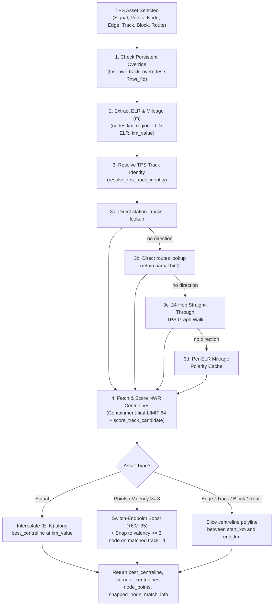

# TPS-to-Geographic (NWR OSGB36) Track Matching & Plotting Guide

This document explains how the application maps railway assets from the **Network Rail TPS Schematic Model** (`XML_p.xml` in schematic `netx, nety` coordinates) onto the **NWR Geographical Track Model** (OSGB36 Eastings/Northings shapefiles).

It is written in two parts:
1. **Data Science & Engineering Reference** — how the 5-stage matching, scoring, snapping, and override pipeline works.
2. **Reusable AI / LLM Prompt Pack** — a copy-pasteable prompt to brief another AI assistant on the exact domain rules, invariants, and debugging workflow.

---

## 1. The Core Problem

TPS and the NWR Track Model are independent datasets with **no shared foreign key** between individual tracks, signals, or points:

- **TPS** provides topological connectivity (`nodes`, `edges`), operational track labels (`station_tracks`, `routes`), signalling metadata (`signals`, `blocks`), line speeds (`edges.vmax`), and linear referencing (**ELR** via `km_region_id` + **mileage** in metres via `km_value`).
- **NWR Track Model** provides OSGB36 polyline geometries (`nwr_track_centrelines`) and physical turnout/boundary nodes (`nwr_track_nodes` with `valency`), keyed by **ELR**, **4-digit Appendix A `track_id`**, and **chainage** (`start_meters`, `end_meters`).

Plotting a TPS asset onto the geographic map therefore requires answering two questions:
1. **Which parallel NWR `track_id` at `(ELR, km_value)` does this TPS asset physically sit on?**
2. **Where along that centreline (or at which physical switch node) should the marker be placed?**

---

## 2. End-to-End Pipeline



All core logic lives in `backend/main.py` (`load_elr_polarity_cache`, `_extract_direction_from_tokens`, `_extract_platform_number`, `_parse_station_track_rows`, `_resolve_reversible_through_line_dir`, `resolve_tps_track_identity`, `score_track_candidate`, `find_nwr_cross_links_for_tps`).

---

## 3. Stage-by-Stage Technical Breakdown

### Stage 1: TPS Track Identity Resolution (`resolve_tps_track_identity`)

Given a TPS asset's node(s) `(start_node_id, end_node_id, point_node_id)`, ELR, and mileage, the resolver extracts:
- `direction_hint`: `"up"`, `"down"`, or `"reversible"`
- `secondary_dir`: `"up"` or `"down"` tiebreaker when `direction_hint == "reversible"` (used when NWR codes a bi-directionalised main line as `1xxx`/`2xxx` instead of `3xxx`)
- `track_name_hint`: combined operational label (`name | description | sa_line_code | rop_line_code`)
- `platform_num`: integer `0..99` extracted from platform, Platform 0, sub-platform, line, bay, or siding numbers (e.g. `U-0R~A / 0 → 0`, `D-12 → 12`, `U-10B~A / 10B → 10`, `Platform 15A → 15`, `U-L3 / Line 3 → 3`, `Middle Siding 1 / Up 3 Siding / No3 Siding / 3SDG → 1/3`), with parent `stations.longname` fallback for numbered siding stations whose `station_tracks` only say `Up Siding` / `Down Siding` (e.g. `GLASGOW CENTRAL N0.1 SDG` → `1`)
- `source`: human-readable audit trail shown in the Inspector UI (e.g. `TPS Track Walk (2 hops: U-UF / U-UF Fast Up)`)

Resolution runs in four cascading steps:

1. **Direct `station_tracks` lookup** (GIN-indexed on `node_ids`):
   - Prefers rows containing both `start_node_id` and `end_node_id` in forward order (`index(start) < index(end)`).
   - **Sibling `SA`/`ROP` line-code inheritance**: When the winning directed row on a bi-directional platform has no `sa_line_code` or `rop_line_code`, inherits them from any sibling row on the exact same physical track (`longname == best_ln`) — e.g. Reading Plat 15 where `U-15` carries `rop=URL` while `D-15` has `None`, or Plat 12 where `U-12` carries `rop=DRL`. If the track's `SA`/`ROP` code names an explicit directional running line (`URL`, `DRL`, `UML`, `DML`, `UF`, `DF`, `US`, `DS`), that physical line's direction is set as `secondary_dir`.
   - Detects **reversible pairs**: if the same physical track (`longname`) has both an Up and a Down row on the matched node(s) (e.g. `D-12` + `U-12` at Crewe, or `D-MBR` + `U-MBR` at Euston), sets `direction_hint = "reversible"` while keeping `secondary_dir` — **unless** the winning row's description explicitly names a single directional running line (e.g. Stafford `Down Slow` / `Up Slow` on `2200`/`1200`), or uses wrong-direction phrasing like `Down Up Slow` (`DUS` → physical Up Slow).
   - **Reversible through-platform running-line walk (`_resolve_reversible_through_line_dir`)**: When a bi-directional through platform (non-bay/non-terminal) has no explicit directional SA line code (only bare platform numbers like `3`/`5` at York or `1` at Warrington Bank Quay) and NWR has no 2-digit platform suffix (only `1100`/`2100`/`1200`), a wrong-direction signal's facing direction (`U-5` on Down Main, `D-3` on Up Main, `D-1` on Up Slow) does not match the physical line. Walking straight-through (`cos_sim >= 0.90` at turnouts, following valency-2 bends) out of the platform onto the adjacent open running line resolves the unanimous physical running-line direction (`Up Main` / `Slow Up` → `up`, `Down Main` / `Fast Down` → `down`) as `secondary_dir`.
   - **Depot / yard / freight terminal siding inference**: When a parent `stations.longname` names a depot, yard, siding, or freight/mail terminal (e.g. `WARRINGTON ROYAL MAIL(DBS)`) and the `station_tracks` row has only bare road numbers (`U-1`/`D-1`) without a running-line class keyword, `"Siding"` is appended to `track_name_hint` so signals match `x9xx`/`x8xx` sidings instead of adjacent mainline running lines.
   - Recognizes UK rail bi-directional codes (`UD*`, `U&D*`, `D&U*`, `U/D*`, `D/U*`, `RVL`, `BGL`, `REV`, `BI`, `BD`) and physical-line prefixes (`U-DM` / `U-DML` = physically Down Main worked in the Up direction, evaluated *before* generic description Up/Down checks so e.g. `U-DM Fast Up` resolves to Down Main `2100`).
2. **Direct `routes` lookup** (GIN-indexed on `node_ids`):
   - Decodes `sa_line_code_id` (`salinecodedesc`) and `rop_line_code_id` (`roplinecodedesc`).
   - **Important**: If a route only supplies a directionless code (e.g. `ML` = Main Line), it is kept as a `partial_hint` and does **not** return early — execution continues to Step 3 and Step 4 to resolve direction.
3. **24-Hop Straight-Through TPS Graph Walk**:
   - Open-line signals and points sit between `station_tracks`. The walker traverses connected TPS `edges` in both directions from `(end_node_id, start_node_id)` and `(start_node_id, end_node_id)` for up to 24 hops.
   - Through **valency-2** nodes: continues unconditionally.
   - Through **turnouts (`deg >= 3`)**: computes the schematic unit vector `prev → curr` in `(netx, nety)` and only follows the single outgoing leg with cosine similarity `>= 0.92` (deflection `<= ~23°`). This passes cleanly through crossovers without ever jumping sideways onto a parallel line.
   - **Hop-1 Turnout Discovery (for Points / Crossover Legs)**: A `POINTS:` asset's `(start_node_id, end_node_id)` is often the 45° diverging crossover leg. At Hop 1, if no outgoing leg satisfies `cos_sim >= 0.92`, the walker finds the two incident edges at that turnout most collinear with each other (`cos_sim <= -0.92`) — i.e. the main running line passing straight through the switch — and walks along that running line.
4. **Dead-End Buffer-Stop Detection & Data-Driven Per-ELR Mileage Polarity Cache (`load_elr_polarity_cache`)**:
   - If an unlabelled signal's `start_node_id` or `end_node_id` is a **valency-1 dead-end (buffer stop)** (e.g. Stafford Platform 2 Bay `LS4310`), it is tagged `Dead-End Bay` (`TPS Dead-End Spur`) so it prefers Terminal Bay (`6: +60`) / Siding (`9: +55`) over Fast/Slow running lines (`1/2: -25`).
   - **Never assume `start_km < end_km` means Down.** Across Great Britain, **247 of 1,106 ELRs (~22%)** are reverse-chained where Down runs in *decreasing* mileage (e.g. `CMD1`).
   - On first use, the backend computes each ELR's polarity (`+1` or `-1`) directly from directed `station_tracks` in PostgreSQL and caches it in memory.

---

### Stage 2: NWR Candidate Retrieval & Appendix A Track Scoring

In NWR's 4-digit `track_id` (`D C NN`):
- **Digit 1 (`D`) — Direction**: `1` = Up, `2` = Down, `3` = Reversible/Bi-directional, `4` = Non-directional
- **Digit 2 (`C`) — Track Class**:
  - `1` = Main / Fast (`1100`, `2100`, `3101`)
  - `2` = Slow / Relief (`1200`, `2200`, `3204`, `3212`)
  - `3` = Goods / Freight (`1300`, `2300`, `3300`)
  - `4` = Single (`1400`, `2400`, `3400`)
  - `5` = Loop / Platform Loop (`1500`, `2500`, `3500`)
  - `6` = Terminal / Bay (`3601`–`3617`)
  - `7` = Crossover (`3700`–`3799`)
  - `8` = Other / Engine / Carriage / Reception (`3800`–`3850`)
  - `9` = Siding / Yard / Depot (`1901`, `2901`, `3901`)
- **Digits 3–4 (`NN`) — Sequence Number**: `00` for primary open-line tracks; `01`–`99` for numbered platforms, numbered approach lines (Paddington `3101`–`3206`), or numbered sidings (`3901`–`3906`).

#### Candidate Query & Multi-ELR Major Hub Fallback
1. `find_nwr_cross_links_for_tps` queries `nwr_track_centrelines` on the primary `elr` within `±400 m` (or `±300 m` of a span), ordered by **strict mileage containment first**, then midpoint distance, with `LIMIT 64`. This ensures long through-platforms at major hubs (Crewe, Euston, Paddington) are never truncated behind short crossovers or bays.
2. **Multi-ELR Station & Flyover Fallbacks**:
   - **Major Multi-ELR Stations**: TPS often tags all platforms with one ELR while NWR splits platforms across adjacent ELRs (e.g. Liverpool Street Plats 11–17 on `LVS` vs `LTN1`, York Plats 2 & 4 on `YMS` vs `ECM5`, Reading Plats 4–6 on `RDG2` vs `MLN1`). Whenever `platform_num` is known and no centreline on the primary ELR has `track_id[2:4] == f"{platform_num:02d}"`, the backend runs a spatial bounding-box query (`±300 m` around the primary ELR's `(E, N)` anchor) across adjacent ELRs for platform tracks ending in that exact 2-digit number, and projects the spatial anchor onto the matched cross-ELR polyline.
   - **Multi-ELR Slow/Relief & Named-Branch Flyovers**:
     - On grade-separated Slow/Relief flyovers (e.g. Norton Bridge Down Slow `SC5609`/`SC5611`/`SC5615` on `LEC6 2200` while TPS tags `LEC4`), when `platform_num is None`, the TPS hint requests Slow/Relief (`d2 == 2`), and no covering same-direction Slow, Goods, or Loop track (`d2 in (2, 3, 5)`) exists within `±50 m` on the primary ELR (preserving e.g. Crewe `CE152` on `CMP1 1500`), the backend searches spatially (`±1200 m`) across adjacent ELRs for a covering `12xx`/`22xx` track at `target_m`.
     - On named-branch flyovers/chords (e.g. `U-UNB` / `D-DNB` Norton Bridge flyover signals `NS4328`–`NS4333`, excluding operational classes like `Indep`/`Goods`/`Loop` so Crewe North `CY55` stays on `LLI 2100`; and diverging `UL`/`DL` branch flyovers like Weaver Junction `WD168`/`WD171` on `WJL1 1100`/`2100` where the primary ELR `CGJ1` has no `xx50` and the adjacent ELR originates within `±1500 m` of `target_m`), the backend first checks for a same-chainage adjacent-ELR flyover (`+25` bonus), and if none exists for a named branch, checks for a uniquely adjacent (or `station_tracks`-confirmed) re-chained branch ELR within `±1500 m` (`NBS 1100`/`2100`, spatially projected via `_cross_elr`).
     - On single-track bi-directional chords: (a) when opposing TPS signals share the exact reverse edge `start_node_id <-> end_node_id` (e.g. `NS5692`/`NS5693`, `NS5694`/`NS5695`), `resolve_tps_track_identity` marks the track `reversible` and `find_nwr_cross_links_for_tps` checks adjacent ELRs (`±1200 m`) for a covering `31xx`/`34xx` chord (`NBS1 3100`); (b) when an adjacent-ELR `3100`/`3400` chord lies within `±1200 m`, a zero-turnout valency-2 walk (`_find_valency2_adjacent_elr`) checks whether the signal's track crosses directly into that adjacent ELR (e.g. `NS5688`/`NS5691` tagged `LEC4` crossing directly into `NBS` → `NBS1 3100`, `+75` topological chord bonus).

#### Scoring Matrix (`score_track_candidate`)
*(All keyword checks use regex word boundaries `\b...\b` so place names like `Wilmslow`, `Hounslow`, or `Winslow` never trigger `"slow"`.)*

| Factor | Condition | Weight |
| --- | --- | ---: |
| **Base** | All candidates | `+50` |
| **Coverage** | Strictly contains `target_m` (`min_m <= target_m <= max_m`) | `+85` |
| | Within `50 m` margin | `+35` |
| | Outside margin (`dist` to nearest endpoint) | `-(40 + min(40, dist * 0.15))` |
| **Direction** | Exact Up (`1xxx`) or Down (`2xxx`) match | `+70` |
| | Reversible (`3xxx`) when Up/Down hinted | `+25` |
| | Opposite direction (`1xxx` vs Down, `2xxx` vs Up) | `-60` |
| | Reversible hinted: `3xxx` / `secondary_dir` match / opposite | `+70` / `+30` / `+10` |
| **Sequence `NN`** | Exact `track_id[2:4] == platform_num` (`0` restricted to bay/station classes `6,8`; `1..99` restricted to `8,9` for sidings, `1,2,4,5,6,8` for explicit running lines so e.g. Gidea Park `435`/`433` never jump onto `2902`/`2904` sidings, else `1,2,4,5,6,8,9`; guarded against opposite-direction `1xxx`/`2xxx` running lines) | `+120` |
| | Different non-zero `track_id[2:4]` in `01..49` (`50..59` are secondary running lines, never platforms) | `-55` |
| | Lettered or numbered approach lines (`U-A`..`U-H` / `A`..`H` or `U-1L`..`D-8L` / `L1`..`L8` → `1..8` vs numbered `01`..`09`, e.g. Euston `A→1101..E→1104`, King's Cross `A→3101..F→3106`, Leeds West `L3644 A→3101`, Glasgow Central `1L..6L` & `A..H → 1101..2208`; guarded against opposite direction and non-covering `>50 m` tracks) | `+125` exact (within `±50 m`, `+40` if `>50 m`) / `-(30..40)` mismatch |
| | Secondary/electric/suburban parallel running lines (`UL`/`DL` Fast or named `Up/Down Leeds`, `EL`/`UE`/`DE`/`UEL`/`DEL`/`Electric`, `USB`/`DSB`/`Suburban`, named branch `D-DE`/`U-UE`) on `xx50`–`xx59` (`LTN1 1152/2152` Electric, `1154/2154` Suburban, `BGK/ECM4/NOC/SPC9 1150/2150`) | `+20` (`+22` exact `52` Electric / `54` Suburban; plus Fast/Main `d2 == 1: +50` for `is_secondary_fast`) |
| | Secondary Slow 2 lines (`SL2`, `DS2`, `US2`, `S2`, `Up/Down Slow 2`, e.g. `ECM1` Hornsey `1202`/`2252`, Peterborough `1252`) on `x202`/`x252` | `+25` |
| | Primary open-line `xx00` (classes `1,2,4`) when not secondary/electric/suburban/Slow 2 | `+5` |
| **Track Class (`C`)** | Engine / Carriage / Reception / Washer / Back Line (`crl`, `ecl`, `cl1`, `w1`, ...) | `8: +55`, `9: +35`, `1/2: -25` |
| | Siding / Yard / Depot / Headshunt (`sdg`, `ms1`, `ms2`, `ms3`, `mbr`, ...) | `9: +55`, `8: +35`, `1/2: -25` |
| | Terminal / Bay | `6: +60`, `1/2: -15`, `7/8/9: -25` |
| | Loop (`loop`, `udl`, `dgl`, `ugl`, `bgl`, `rvl`, `dpl`, `upl`, `udpl`, `dupl`, `dbp`, `ubp`, `d&ul`; `dl`/`ul` only when not Fast/named line) | `5: +55`, `2 (with Slow/Relief): +50`, `1 (with Slow/Relief): -15`, `3 (goods): +20`, `6/7/8/9: -25` |
| | Goods / Freight / Independent (`dg`, `ug`, `dmi`, `mil`, ...) | `3: +55`, `2: +25`, `5: +10`, `1: -20` |
| | Single (`single`, `sgl`) | `4: +55` (+`15` if `34xx`) |
| | Dedicated `Platform` (without Fast/Slow/Bay in description) | `5 (loop): +75`, `1/2 (dml/drl/uf/ds): +35/+15`, `8 (exact plat #): +5`, `7/9: -30` |
| | Slow / Relief / Local (`ds`, `us`, `sl`, `rl`, `l2`, `up 2`, `down 2`) | `2: +50`, `1: -15`, `6/8: -30`, `7/9: -40` |
| | Fast / Main (`dm`, `um`, `df`, `uf`, `ml`, `fl`, `l1`, `up 1`, `down 1`) | `1: +50`, `2 (rev/plat): +10` else `-10`, `8 (exact plat #): +5` else `-35`, `6: -35`, `7: -40`, `9: -45` |
| **Line Speed (`vmax`)** | Only when no class matched: `vmax >= 145 km/h` → `d2 == 1` | `+20` |
| | Only when no class matched: `0 < vmax <= 80 km/h` → `d2 == 2` | `+15` |
| **Default Signal Class** | Only when no class matched on signals: running line (`1,2,4`) / crossover (`7`) / other-siding (`8,9`) | `+10` / `-45` / `-15` |
| **Switch Proximity** | Points only: `valency >= 3` NWR endpoint within `15 m` / `35 m` of `target_m` | `+60` / `+35` |

---

### Stage 3: Coordinate Placement & Points Snapping

- **Signals**: Interpolated directly along `best_centreline` at `km_value` (`interpolate_pt_along_coords`) — never hijacked to nearby nodes on adjacent tracks.
- **Points (`asset_type == "points"` or `tps_valency >= 3`)**: Queries up to 32 `nwr_track_nodes` within 90 m of the interpolated point, tagged with `on_matched_track` (whether the node is an endpoint of any centreline with the same `(elr, track_id)`), and picks in priority order:
  1. `valency >= 3` switch on `matched_track`
  2. `valency >= 3` switch within 20 m
  3. Any node on `matched_track`
  4. Nearest `valency >= 3` switch
  5. Nearest node
- **Linear assets (Edges, Tracks, Blocks, Routes)**: The matched centreline is clipped between `start_km` and `end_km` via `slice_polyline`.

---

### Stage 4: Manual Track Switcher & Persistent Overrides

Because some real-world locations have genuine dataset-coding disagreements (e.g. unnumbered yard sidings all named `U-SDG`, or NWR transition zones where a single physical track changes from `3101` to `2100` while TPS still labels an Up signal `U-1`), the app provides a full override loop:

- **PostgreSQL Table** (`backend/schema.sql`, lazily created on existing DBs):
  ```sql
  CREATE TABLE IF NOT EXISTS tps_nwr_track_overrides (
      asset_type TEXT NOT NULL,
      asset_id BIGINT NOT NULL,
      nwr_fid INTEGER NOT NULL,
      updated_at TIMESTAMPTZ DEFAULT NOW(),
      PRIMARY KEY (asset_type, asset_id)
  );
  ```
- **API Endpoints** (`backend/main.py`):
  - `GET /api/asset/{asset_type}/{asset_id}?nwr_fid=<fid>` — preview on any corridor centreline without saving.
  - `POST /api/nwr/track-override` — persist `{"asset_type", "asset_id", "nwr_fid"}` in PostgreSQL.
  - `DELETE /api/nwr/track-override/{asset_type}/{asset_id}` — remove saved override and revert to automatic matching.
- **Inspector UI** (`backend/static/app.js`): Shows `Match Basis`, a **Plot on Track** corridor dropdown, **💾 Save**, and **↺ Auto**.

---

## 4. Automated Auditing, Regression Testing & Data Upgrades

### Auditing & Regression Commands
Use `backend/audit_track_matching.py` to audit matching quality across stratified UK-wide samples or the busiest multi-platform hubs, and `backend/test_track_matching.py` to verify all 138 locked-in real-world regression cases:

```bash
docker exec nr_schematic_app python3 /app/test_track_matching.py
docker exec nr_schematic_app python3 /app/audit_track_matching.py --mode hubs --limit 30
docker exec nr_schematic_app python3 /app/audit_track_matching.py --mode hubs --station YORK
docker exec nr_schematic_app python3 /app/audit_track_matching.py --mode signals --limit 1200
docker exec nr_schematic_app python3 /app/audit_track_matching.py --mode points --limit 1000

# Full-network batched audit snapshot (all ~55k signals + ~14k points, persisted in ./audit_snapshots)
docker exec nr_schematic_app python3 /app/batch_audit.py \
    --out /app/audit_snapshots/baseline.jsonl.gz --workers 6 --batch-size 1000

# Re-summarize or export anomalies CSV from any saved snapshot
docker exec nr_schematic_app python3 /app/batch_audit.py \
    --summarize /app/audit_snapshots/baseline.jsonl.gz \
    --csv /app/audit_snapshots/baseline_anomalies.csv

# Before/After diff report to validate code changes & catch UK-wide regressions
docker exec nr_schematic_app python3 /app/batch_audit.py \
    --diff /app/audit_snapshots/baseline.jsonl.gz /app/audit_snapshots/after.jsonl.gz \
    --csv /app/audit_snapshots/diff.csv
```

**Automated Anomaly Detectors (`audit_track_matching.py`):**
- `dir_mismatch`: Up signal on `2xxx` or Down signal on `1xxx`.
- `plat_num_mismatch` / `plat_num_missed_exact`: Resolved `platform_num` landed on a different non-zero `NN`, or on `xx00` when a covering non-siding exact `NN` candidate exists.
- `class_mismatch`: TPS Fast/Main vs Slow/Relief/Bay/Siding contradiction against NWR digit 2 (excluding exact platform-number matches and corridors with no siding/bay track).
- `non_covering_match`: Same-ELR match `> 50 m` outside `[start_meters, end_meters]` when another same-ELR candidate covers `km`.
- `same_platform_split` (`--mode hubs`): Signals on the **exact same physical TPS `station_track`** landing on different NWR `track_id`s (catches swapped bi-directional platform signals without manual ground truth).
- `parallel_collision` (`--mode hubs`): Distinct parallel TPS tracks at the same `(ELR, km ± 10 m)` colliding onto the same NWR `track_id` when another matching-direction track exists (catches `1100`/`1150` and `2100`/`2150` collisions).

**Observed Network-Wide Benchmarks:**
- **Regression Suite**: **138 / 138** passing across Stoke (`CMD1`/`CMD2`), Crewe & North (`LEC5`/`CMP1`/`LLI`), Stafford & Norton Bridge Flyover (`LEC3`/`LEC4`/`LEC6`/`NBS`/`NBS1`), Warrington Bank Quay & Royal Mail (`CGJ3`), Weaver Junction Flyover (`CGJ1`/`WJL1`), Paddington/Old Oak Common/Didcot (`MLN1`), Euston & Camden Bank (`LEC1`), King's Cross & ECML South (`ECM1`, including Platform 0 `3600`, `10B`, Lines `A`–`F`, Slow 2 `1202`/`2252`/`1252`, Huntingdon Bay `1201`, Newark `3500`, Doncaster), Glasgow Central & Approaches (`WCM2`, Lines `1L`–`6L`, `A`–`H` & sidings), Liverpool Street / Great Eastern (`LTN1`/`LVS`/`BGK`, Electric `1152/2152`, Suburban `1154/2154`, `BGK 1150/2150`, Gidea Park), York & York South Approach (`ECM4`/`ECM5`/`YMS`/`NOC`), Leeds East & West (`DOL2`/`HUL4`, including `L3644`/`L3631` Lines `A`–`F`), Midland Main Line / Erewash (`SPC9`), Birmingham New Street (`RBS1`/`RBS2`), and Reading (`MLN1`).
- **30-Hub Sweep (1,146 hub signals)**: **0** direction mismatches, **1** class mismatch, **4** missed exact platform numbers; **0 anomalies** at York, Reading, and Ipswich; **1** at Euston, King's Cross, Guildford, and Newcastle; **2** at Birmingham New Street (100 signals).
- **Signals (1,200 stratified UK signals)**: 95.4% resolved via `TPS Track` / `TPS Track Walk`; `< 1%` main-line ties (`1100/2100`: 2, `1100/1200`: 4, `2100/2200`: 3); total ties halved from 14.4% → 7.2% (mostly unnumbered yard sidings).
- **Points (1,000 stratified UK points)**: 97.2% resolved via `TPS Track` / `TPS Track Walk` (up from 33.1%); 0% missing direction; 86.1% snapped to a physical `valency >= 3` switch on the matched `track_id` (up from 73.7%); main-line ties dropped 94% (33 → 2).

### Data Refresh & Portability Across New Dataset Releases
- **Automatic matching (`backend/main.py`) is 100% generic**: There are **zero** hardcoded station names, ELR names, signal IDs, or NWR `fid`s in the matching engine. Per-ELR mileage polarity is recomputed dynamically from `station_tracks`, the 24-hop straight-through graph walk uses live topology, and Appendix A `D C NN` scoring + multi-ELR spatial fallback work purely from standard Network Rail conventions. All matching improvements automatically persist across any new TPS XML freeze or NWR TrackModel shapefile release.
- **What IS ID-sensitive on a full drop-and-reingest**:
  1. **`tps_nwr_track_overrides`**: Currently keyed by `(asset_type, asset_id, nwr_fid)` where `asset_id` is PostgreSQL's ingestion-time `pk` and `nwr_fid` is the shapefile record `fid`. Before relying on many saved manual overrides across future dataset upgrades, migrate the table to store stable natural keys (e.g. TPS `signal_id` / `node_id` + NWR `(elr, track_id, asset_id)`).
  2. **`backend/test_track_matching.py`**: Uses `signals.pk` for fast lookup; when upgrading to a new TPS XML freeze, migrating test lookups to `(name, elr)` or `signal_id` will keep the suite portable across re-ingestions.

---

## 5. Reusable AI / LLM Prompt Pack

Copy and paste the prompt below when briefing another AI assistant to investigate, extend, or debug TPS-to-NWR geographic plotting in this repository:

```text
You are working on the Network Rail TPS Schematic & NWR Geographical Track Model Explorer
(FastAPI + PostgreSQL 16 + vanilla HTML5 Canvas frontend).

### How TPS-to-Geographic Plotting Works
TPS (schematic XML_p.xml) and NWR Track Model (OSGB36 shapefiles) have no shared track foreign key.
All cross-model plotting runs through `backend/main.py`:
1. `resolve_tps_track_identity(cur, node_ids, start_node_id, end_node_id, elr, start_km, end_km)`:
   - Checks `station_tracks` (GIN-indexed `node_ids`) and `routes` for direction (`up`/`down`/`reversible`),
     `secondary_dir`, `track_name_hint`, and `platform_num` (`_extract_platform_number`).
   - Directionless hints (e.g. route code `ML`) are kept as `partial_hint` and NEVER short-circuit
     before direction is resolved.
   - Walks up to 24 hops along TPS `edges`: follows valency-2 nodes, and at turnouts (`deg >= 3`)
     follows ONLY the single collinear straight-through leg (`cos_sim >= 0.92` in schematic `netx, nety`).
     At Hop 1 (e.g. `POINTS:` on a 45° crossover leg), discovers the collinear running-line pair
     (`cos_sim <= -0.92`) passing straight through the turnout.
   - Falls back to `load_elr_polarity_cache(cur)` — a data-driven per-ELR mileage polarity map
     (247 of 1,106 UK ELRs are reverse-chained where Down = decreasing mileage, e.g. `CMD1`).
2. `find_nwr_cross_links_for_tps(...)` + `score_track_candidate(...)`:
   - Fetches up to 64 `nwr_track_centrelines` ordered by strict mileage containment first; if a
     numbered platform (`platform_num`) isn't on the primary ELR, runs a ±300 m spatial multi-ELR
     fallback for exact 2-digit platform tracks (e.g. `LVS` at Liverpool St, `YMS` at York, `RDG2` at Reading).
   - Scores NWR Appendix A 4-digit `track_id`s (`D C NN`: D=1 Up/2 Down/3 Rev, C=1 Fast/2 Slow/3 Goods/
     4 Single/5 Loop/6 Bay/7 Crossover/8 Engine-Carriage-Reception-HubPlatform/9 Siding, NN=Platform/Line/Siding #).
   - Uses regex word boundaries (`\bslow\b`, `\bfast\b`, `\bmain\b`) so place names like `Wilmslow` never misfire.
   - Strict containment (+85) strongly outranks non-overlapping segments (-(40 + 0.15*dist)) so a
     nearby segment can never hijack an asset away from its mileage.
   - Exact `NN == platform_num` gives +120, explicit wrong `NN` (01..49; 50..59 are secondary running lines) gives -55;
     `edge_vmax` breaks Fast (>=145 km/h) vs Slow (<=80 km/h) ties when no class matched, prevents high-speed through-line
     platforms (>=70 km/h) from matching low-speed `x5xx` platform loops, and allows a covering `x501` loop for low-speed
     (10..48 km/h) non-Fast platforms (e.g. Luton Plat 1 = `1200` @ 89 km/h, Plat 2 = `3501` @ 32 km/h).
   - Points get +60/+35 for `valency >= 3` NWR switch endpoints within 15/35m; `DR`/`UR` tokens map to Slow/Relief (`x2xx`).
   - Re-chained branch ELR Check 2 requires `target_m >= 5000m` and branch start `< 5000m` so zero-based branches (e.g. `NBS`)
     never jump backwards onto high-chainage trunk ELRs (`LEC4`).
3. Placement & Overrides:
   - Signals interpolate along `best_centreline` at `km_value` (or project spatially for cross-ELR platforms).
   - Points snap to `nwr_track_nodes` prioritizing `valency >= 3` switches on the matched `track_id`.
   - Persistent manual overrides live in `tps_nwr_track_overrides` via `POST/DELETE /api/nwr/track-override`.

### Invariants — Do NOT Break These
- NEVER hardcode station names, ELRs, signal IDs, or NWR `fid`s in the matcher — keep all rules generic.
- NEVER hardcode `start_km < end_km => down`; always use `infer_direction_from_km_delta`.
- NEVER allow a non-overlapping centreline to outscore a strictly covering centreline.
- NEVER short-circuit `resolve_tps_track_identity` when `direction_hint` is `None`.
- Always run `./run_tests.sh` (Pylint must stay 10.00/10), the 154-case regression suite, and UK-wide batched audits:
  `docker exec nr_schematic_app python3 /app/test_track_matching.py`
  `docker exec nr_schematic_app python3 /app/batch_audit.py --elr <ELRS> --out /app/audit_snapshots/after.jsonl.gz`
  `docker exec nr_schematic_app python3 /app/batch_audit.py --diff /app/audit_snapshots/baseline_cd3779b.jsonl.gz /app/audit_snapshots/after.jsonl.gz`

### Debugging Workflow for Any Mis-Plotted Asset
1. Query the asset's `start_node_id`, `end_node_id`, `km_value`, `elr`, and `station_tracks` in PostgreSQL.
2. Inspect `resolve_tps_track_identity` output and the top 6 `corridor_centrelines` with `_score`.
3. Determine whether the mismatch is:
   (a) a missing TPS token/class rule or graph-walk stop (fix generally in `backend/main.py`), or
   (b) a genuine TPS-vs-NWR dataset coding boundary (document or pin via `tps_nwr_track_overrides`).
```

